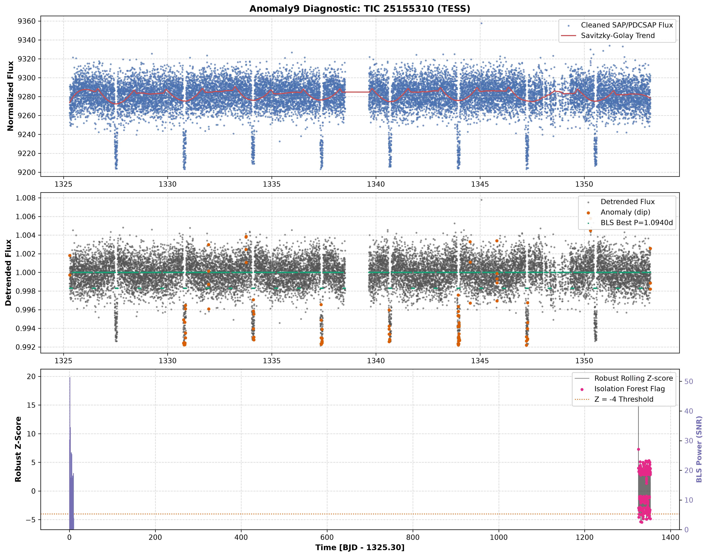

# Anomaly9

**Production-grade TESS transit detection and astrophysical vetting pipeline.**

Anomaly9 ingests multi-sector TESS light curves, detects transit candidates with a dual-engine approach (BLS periodogram + Isolation Forest anomaly scoring), and applies six research-grade vetting checks with physical stellar priors from Gaia DR3 / TIC v9. Results persist to SQLite (WAL mode) and export to CSV/JSON for downstream analysis.

---

## Architecture

```
┌─────────────────────────────────────────────────────────────────────────────┐
│                           ANOMALY9 PIPELINE                                 │
├─────────────────────────────────────────────────────────────────────────────┤
│                                                                             │
│  ┌──────────┐    ┌──────────────┐    ┌──────────────┐    ┌────────────┐   │
│  │  MAST    │───▶│  Ingestion   │───▶│  Detection   │───▶│  Vetting   │   │
│  │  Query   │    │  (multi-sect)│    │  (dual-engine)│   │  (6 checks)│   │
│  └──────────┘    └──────────────┘    └──────┬───────┘    └─────┬──────┘   │
│                                              │                  │          │
│                                              ▼                  ▼          │
│                                    ┌─────────────────┐  ┌─────────────┐   │
│                                    │  BLS Engine     │  │ Duration/   │   │
│                                    │  Periodogram    │  │ Period      │   │
│                                    │  (SNR, depth,   │  │ Consistency │   │
│                                    │   duration)     │  │ (ρ★ prior)  │   │
│                                    └────────┬────────┘  └──────┬──────┘   │
│                                             │                 │          │
│                                    ┌────────┴────────┐  ┌─────┴──────┐    │
│                                    │ Isolation Forest│  │ Odd/Even,  │    │
│                                    │ + Z-score       │  │ Secondary, │    │
│                                    │ (anomaly score) │  │ Shape, SPNR│    │
│                                    └────────┬────────┘  └────────────┘    │
│                                             │                             │
│                                             ▼                             │
│                                    ┌─────────────────┐                    │
│                                    │  Weighted Scorer│                    │
│                                    │  (7 weights)    │                    │
│                                    └────────┬────────┘                    │
│                                             │                             │
│                                             ▼                             │
│                                    ┌─────────────────┐                    │
│                                    │  Disposition:   │                    │
│                                    │  CANDIDATE /    │                    │
│                                    │  AMBIGUOUS /    │                    │
│                                    │  FALSE_POSITIVE │                    │
│                                    └────────┬────────┘                    │
│                                             │                             │
│                    ┌────────────────────────┼────────────────────────┐   │
│                    ▼                        ▼                        ▼   │
│           ┌───────────────┐        ┌───────────────┐        ┌───────────────┐
│           │  SQLite WAL   │        │  CSV/JSON     │        │  5-panel PNG  │
│           │  candidates.db│        │  ranked export│        │  diagnostics  │
│           └───────────────┘        └───────────────┘        └───────────────┘
│                                                                             │
└─────────────────────────────────────────────────────────────────────────────┘
```

---

## Key Features

| Feature | Description |
|---------|-------------|
| **Dual-Engine Detection** | BLS periodogram (SNR, depth, duration) + Isolation Forest + robust Z-score for anomaly scoring |
| **Physical Vetting** | 6 checks: SNR, odd/even depth, duration/period (ρ★ prior from Gaia/TIC), transit shape, secondary eclipse, SPNR, momentum dump proximity |
| **Catalog Cross-Match** | Gaia DR3 (RUWE, ρ★), TIC v9 (R★, M★, Teff), ExoFOP-TESS (TOI dispositions) with local TTL cache |
| **Persistent Storage** | SQLite WAL mode, thread-safe connections, upsert-on-tic_id, export to CSV/JSON |
| **Configuration** | TOML (`anomaly9.toml`) with CLI override precedence, `generate_default_toml()` helper |
| **CLI** | Single-target or batch (`anomaly9-batch`), parallel workers, `--skip-existing`, `--catalog-match` |
| **Diagnostics** | 5-panel PNG: raw/detrended LC, periodogram, phase-fold, vetting matrix, anomaly scores |

---

## Quickstart

### Installation

```bash
git clone https://github.com/your-org/anomaly9
cd anomaly9
python -m venv .venv
.venv\Scripts\activate
pip install -e ".[dev]"
```

### Generate Config Template

```bash
anomaly9-batch --init-config --config anomaly9.toml
```

### Single Target (no catalog queries)

```bash
anomaly9-batch --tic 307210830 --config anomaly9.toml --db sqlite:///anomaly9.db --catalog-match none
```

### Batch from Catalog File

```bash
# newline-separated TIC IDs
anomaly9-batch --catalog targets.txt --config anomaly9.toml --db sqlite:///anomaly9.db --workers 4

# CSV with 'tic_id' column
anomaly9-batch --catalog targets.csv --config anomaly9.toml --db sqlite:///anomaly9.db --workers 4
```

### Skip Already-Processed Targets

```bash
anomaly9-batch --catalog targets.txt --config anomaly9.toml --db sqlite:///anomaly9.db --skip-existing
```

### Enable Catalog Enrichment

```bash
anomaly9-batch --catalog targets.txt --config anomaly9.toml --db sqlite:///anomaly9.db --catalog-match gaia,tic,exofop
```

---

## Diagnostic Output

Five-panel diagnostic figure saved per candidate:



Panels:
1. **Raw Light Curve** — multi-sector stitched flux with quality flags
2. **Detrended Light Curve** — Savitzky-Golay detrended, momentum dumps masked
3. **BLS Periodogram** — SNR vs period, best peak highlighted
4. **Phase-Folded Transit** — folded at best period with model overplot
5. **Vetting Matrix** — 6 checks with pass/fail, weighted score, disposition

---

## Configuration (`anomaly9.toml`)

```toml
[mast]
rate_limit = 1.0        # MAST query delay (seconds)
cloud_dataset = true    # Use AWS S3 streaming
max_sectors = 6         # Max sectors per target

[detector]
period_min = 0.5        # Minimum trial period [days]
period_max = 10.0       # Maximum trial period [days]
period_step = 0.002     # Period grid step [days]
contamination = 0.01    # Isolation Forest contamination
z_window = 25           # Rolling Z-score window
bls_top_n = 5           # Top BLS peaks to retain

[vetting]
snr_threshold = 7.0
odd_even_threshold = 0.3
spnr_threshold = 7.0
duration_min_ratio = 0.001
duration_max_ratio = 0.1
secondary_eclipse_threshold = 0.1
transit_shape_threshold = 0.7
momentum_dump_tolerance = 0.2

[catalog]
enable_gaia = true
enable_tic = true
enable_exofop = true
cache_ttl_days = 30
timeout_seconds = 10.0

[output]
output_dir = "output"
diagnostics_dir = "diagnostics"
cache_dir = "data/cache"
plot_dpi = 300
plot_format = "png"

[database]
url = "sqlite:///candidates.db"
wal_mode = true
busy_timeout = 30000
```

CLI flags override TOML values (e.g., `--period-min 1.0`).

---

## Database Schema

```sql
-- Runs table
CREATE TABLE runs (
    run_id TEXT PRIMARY KEY,
    timestamp REAL NOT NULL,
    config_hash TEXT NOT NULL,
    target_count INTEGER NOT NULL,
    notes TEXT
);

-- Candidates table (upsert on tic_id)
CREATE TABLE candidates (
    tic_id TEXT PRIMARY KEY,
    run_id TEXT NOT NULL,
    period_days REAL,
    t0_btjd REAL,
    depth_ppm REAL,
    duration_hours REAL,
    snr REAL,
    isolation_score REAL,
    vetting_score REAL,
    disposition TEXT NOT NULL,  -- CANDIDATE, AMBIGUOUS, FALSE_POSITIVE, KNOWN_FP
    stellar_radius REAL,
    stellar_mass REAL,
    stellar_density REAL,
    ruwe REAL,
    exofop_toi TEXT,
    exofop_disp TEXT,
    checks_json TEXT,
    reviewed INTEGER DEFAULT 0,
    reviewer_notes TEXT,
    updated_at REAL NOT NULL
);
```

---

## Testing

```bash
# Full suite (127 tests)
pytest -v

# Specific modules
pytest tests/test_catalog.py -v
pytest tests/test_config_and_storage.py -v
pytest tests/test_vetting.py -v
```

**Result:** `127 passed, 0 failed`

---

## Project Structure

```
anomaly9/
├── src/anomaly9/
│   ├── __init__.py
│   ├── cli.py              # Batch CLI entry point
│   ├── pipeline.py         # Ingestion, stitching, batch runner
│   ├── detector.py         # BLS + Isolation Forest engines
│   ├── config.py           # TOML config system
│   ├── storage.py          # SQLite WAL persistence
│   ├── catalog.py          # Gaia/TIC/ExoFOP cross-match
│   └── vetting/
│       ├── __init__.py
│       ├── checks.py       # 6 vetting checks
│       └── scorer.py       # Weighted disposition scorer
├── tests/
│   ├── test_anomaly9.py
│   ├── test_batch_pipeline.py
│   ├── test_catalog.py
│   ├── test_config_and_storage.py
│   ├── test_vetting.py
│   └── test_cli_and_normalization.py
├── examples/
│   ├── diagnostic.png
│   ├── TIC_307210830_diagnostic.png
│   └── ...
├── anomaly9.toml           # Generated config template
├── pyproject.toml
└── README.md
```

---

## Requirements

- Python 3.11+
- `lightkurve`, `astroquery`, `astropy` (MAST, Gaia, TIC)
- `scikit-learn` (Isolation Forest)
- `numpy`, `scipy`, `matplotlib`
- `tomllib` (stdlib, Python 3.11+)

---

## License

MIT License. See `LICENSE` for details.